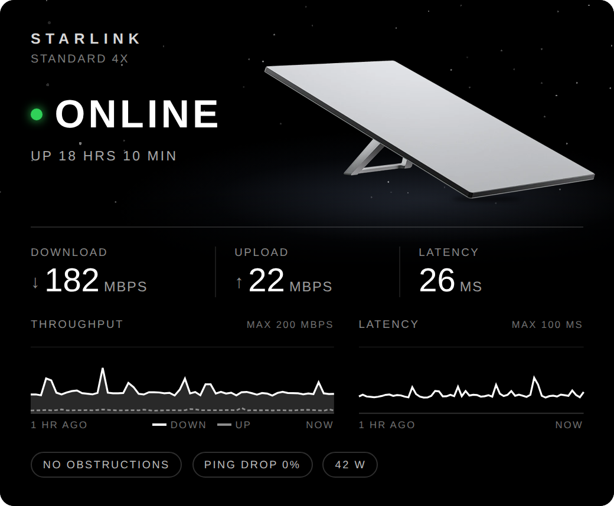
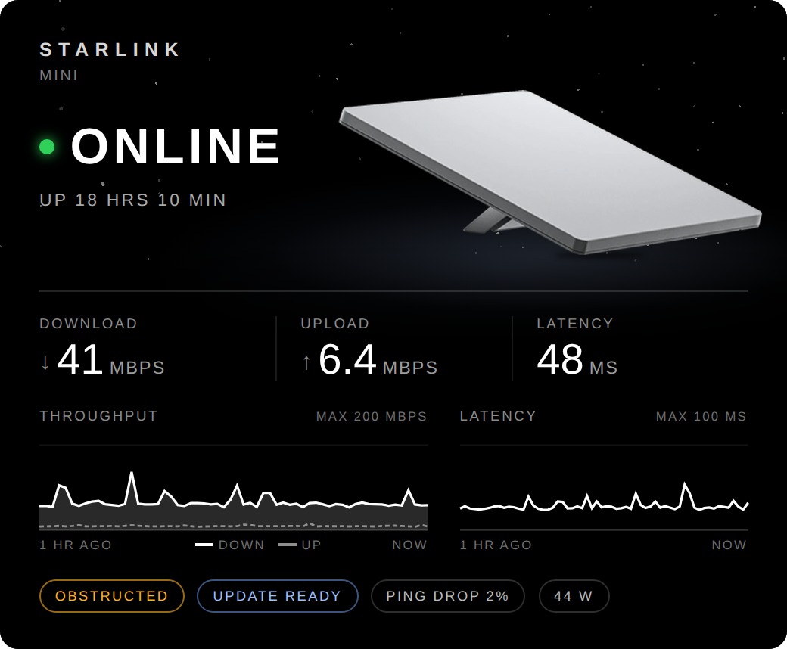
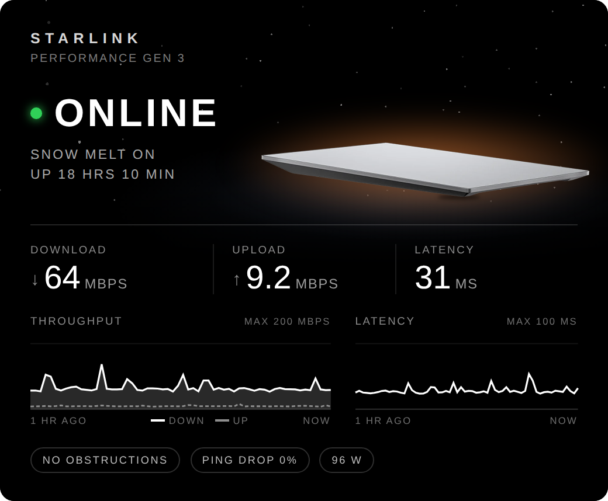
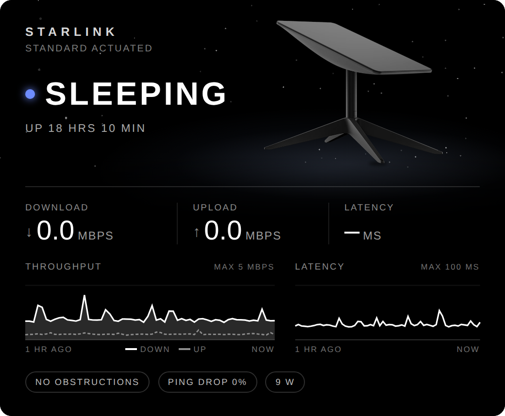
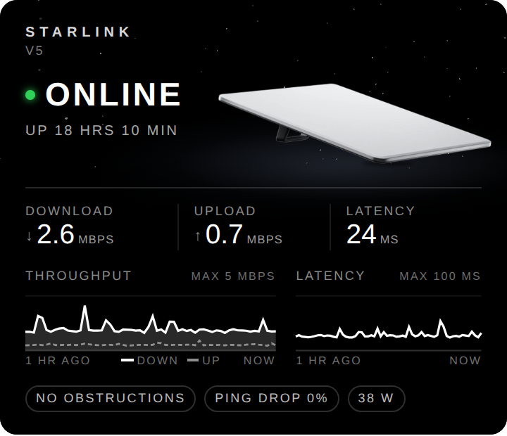
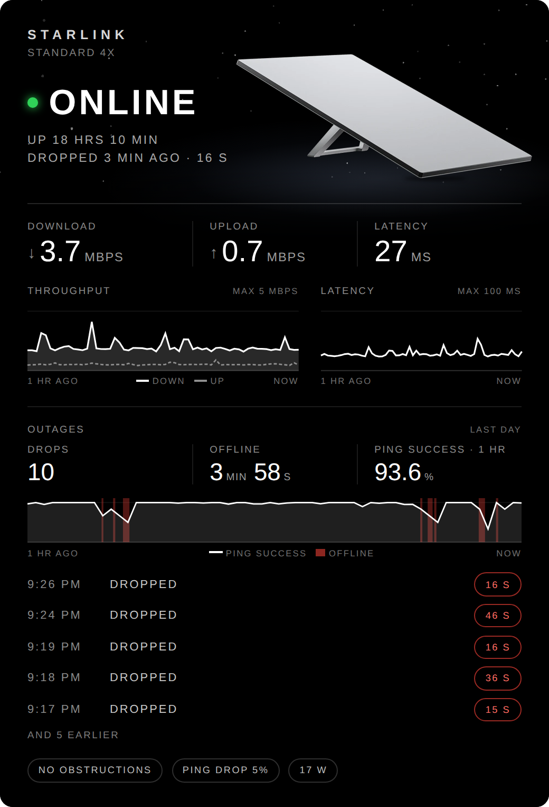
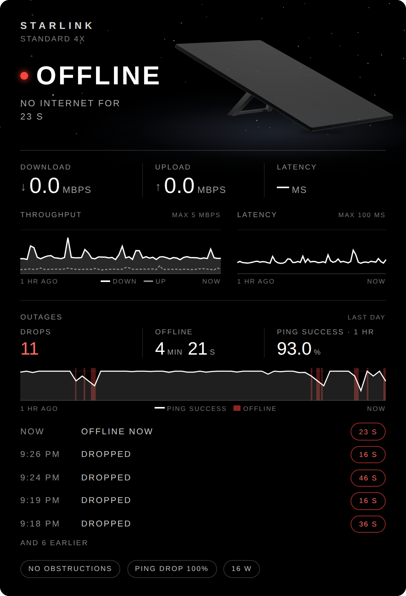
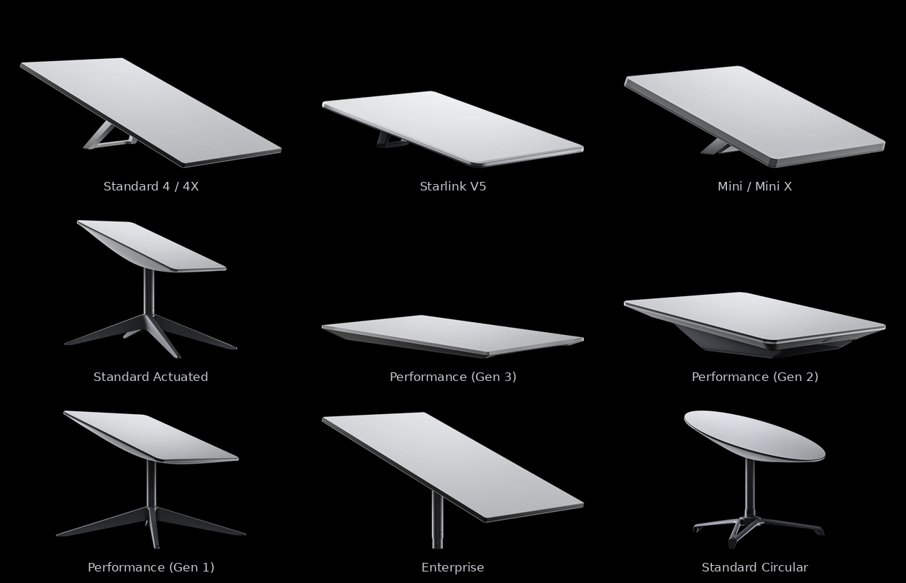

# Starlink card for Home Assistant

A card that shows your Starlink dish the way Starlink shows it: your dish, in Starlink's own product
photo, under a night sky, in a DIN typeface like Starlink's. It tells you whether the dish is online, sleeping,
stowed or offline, with live download, upload and latency, the last hour as two small graphs, every
drop in the connection as it happens, and any alerts. It reads everything from Home Assistant's built-in
[Starlink](https://www.home-assistant.io/integrations/starlink/) integration.



## What it looks like

| | |
|:---:|:---:|
|  |  |
| **Alerts.** Problems the dish reports show as amber chips and notices as blue ones (here a Mini that's obstructed, with an update ready). | **Snow melt.** While the dish is heating itself, it glows warm (here a Performance Gen 3). |
|  |  |
| **Sleeping.** In power-save, the dish goes grey and the dot turns blue (here a Standard Actuated). | **On a phone.** Everything is sized to the card's width (here a Starlink V5). |
|  |  |
| **Outages.** Each drop as it happens: how many, how long offline, ping success over the graph's hour with the drops shaded, and the latest ones. | **Down now.** While the connection's down, the card counts the seconds. |

## Every Starlink dish

The card has Starlink's photo of every dish, and shows yours:



By default it works out which dish you have from the hardware version the dish reports. To choose
it yourself, set `model` (or pick it in the card's editor):

| `model:` | Kit | Dish shown |
|---|---|---|
| `auto` (default) | Worked out from the dish (see below) | |
| `standard_4x` | Standard 4X | Standard (V4) |
| `standard_4` | Standard 4 | Standard (V4) |
| `standard` | Standard, any kit with the V4 dish | Standard (V4) |
| `v5` | Starlink V5 | V5 |
| `mini` | Mini | Mini |
| `mini_x` | Mini X | Mini |
| `standard_actuated` | Standard Actuated (the earlier rectangular dish, with a motor) | Standard Actuated |
| `performance_gen_3` | Performance (Gen 3) | Performance (Gen 3) |
| `performance_gen_2` | Performance (Gen 2), formerly Flat High Performance | Performance (Gen 2), on its wedge mount |
| `performance_gen_1` | Performance (Gen 1), formerly High Performance | Performance (Gen 1) |
| `enterprise` | Enterprise | Enterprise, on its mast |
| `standard_circular` | Standard Circular, the original round dish | Standard Circular |

Older names work too: `high_performance`, `flat_high_performance`, `actuated`, `circular`, `v4`, and
the kit names as Starlink writes them (`Standard 4X`, `Mini X` and so on).

### How the card works out your dish

Home Assistant shows each Starlink's hardware version on its device page (for example
`rev4_panda_prod2`). The card reads it and picks the dish:

| Hardware version contains | Dish |
|---|---|
| `mini` | Mini |
| `rev5` | Starlink V5 |
| `hp1` | Performance (Gen 1) |
| `rev4` | Standard |
| `rev3` | Standard Actuated |
| `rev1`, `rev2` | Standard Circular |
| anything else | Standard |

The hardware version describes the dish, not the kit it came in, so detection can't tell a
Standard 4 from a Standard 4X (same dish, different router) or a Mini from a Mini X. It shows
"Standard" or "Mini"; set `model` if you'd like your kit's exact name. The Performance (Gen 2),
Performance (Gen 3) and Enterprise dishes may report the same family as another dish, so if yours
shows the wrong picture, set `model`.

## What the card shows

| On the card | Comes from |
|---|---|
| Online, Sleeping, Stowed or Offline | the connectivity, sleep and stowed entities |
| Up time | the last restart sensor |
| Snow melt on, and the warm glow | the heating sensor |
| Download, upload, latency | the throughput and ping sensors |
| The two graphs | Home Assistant's history of those sensors |
| Alert chips | the obstructed, thermal throttling, motors stuck, mast not vertical, slow Ethernet, unexpected location, roaming and update sensors |
| Ping drop, power | the ping drop rate and power sensors |
| Outages: drops, time offline, ping success, the shaded graph and the latest drops | the connectivity sensor (its history, and each change as it happens), the ping drop rate's history, and the obstructed, sleep and stowed sensors (a drop while obstructed is marked; time asleep or stowed isn't counted) |

Tap the dish, the status or any figure to open its details in Home Assistant.

### Known limitations

- **Only as fresh as the integration.** The figures update each time Home Assistant polls the dish.
- **Throughput is what's flowing now,** not a speed test. A quiet connection shows a low number.
- **The graphs need history.** If the Starlink sensors are excluded from Home Assistant's recorder,
  the graphs stay empty, and outages only count from when the card was opened.
- **Drops are as fine as the polling.** Home Assistant checks the dish every few seconds, so a drop
  shorter than that can be missed, and each length is right to within a few seconds.
- **No reasons for drops.** The integration doesn't say why the dish dropped out, so the card can't
  show the causes the Starlink app does ("sky search", "unable to reach satellite"). It does mark a
  drop that happened while the dish was obstructed.
- **Kits that share a dish** look the same to the card (see above).
- **The round dish's photo is smaller** than the others (Starlink only publishes it at 500 px), so
  it's a little softer on a large screen.

Built and tested with a Standard 4X on Home Assistant 2026.9.

## Install

You need Home Assistant 2024.11 or later with the
[Starlink](https://www.home-assistant.io/integrations/starlink/) integration set up. When you add
it, it asks for the dish's address; the address it suggests, `192.168.100.1:9200`, is right for most
setups.

**With HACS**

1. In HACS, open the menu (⋮) → **Custom repositories**, add
   `https://github.com/CameronSmith93/Starlink-Card-HA` and choose **Dashboard** as the type.
2. Find **Starlink Dish Card**, download it, and reload the browser when HACS asks.

**By hand**

1. Copy `dist/starlink-dish-card.js` to `/config/www/` in Home Assistant.
2. **Settings → Dashboards → ⋮ → Resources → Add resource**: URL `/local/starlink-dish-card.js`,
   type **JavaScript module**.
3. Reload the browser.

The card is one self-contained file: every dish photo and the typeface are built into it.

## Add the card

**Edit dashboard → Add card**, search for **Starlink**, and choose your dish in the editor. Or in
YAML:

```yaml
type: custom:starlink-dish-card
model: standard_4x
```

That's all most people need: the card finds your Starlink by itself. It's designed for a full-width
slot in a sections view, and works from about 360 px wide (a phone).

### Options

| Option | Default | What it does |
|---|---|---|
| `model` | `auto` | Which dish to show and the name under STARLINK (see Every Starlink dish). A name the card doesn't know is shown as you wrote it, with the detected dish. |
| `device` | the first Starlink | Which Starlink, if you have more than one. The editor lists them; in YAML it's the device ID. |
| `history_minutes` | `60` | How far back the graphs go, in minutes (and the window for ping success) |
| `show_outages` | `true` | Show the outages section |
| `outage_hours` | `24` | How far back drops are counted and listed, in hours (up to 168) |
| `entity_prefix` | | Only needed if the card can't find your dish: the part shared by its entity IDs, e.g. `starlink` for `binary_sensor.starlink_connectivity` |

The card finds the Starlink's entities by what they are rather than by their entity IDs, so it
works whatever language Home Assistant was in when you added the dish, and if you've renamed them.

## What's in the repository

| Folder | What it holds |
|---|---|
| [`dist/`](dist/) | The card, ready to install: one file with every dish photo and the typeface built in |
| [`src/`](src/) | The card's source |
| [`assets/`](assets/) | Starlink's photos (`photos/`), the dish images the card uses (`dishes/`), and the D-DIN typeface (`fonts/`) |
| [`tools/`](tools/) | `make_dishes.py` makes the dish images, `build.py` builds `dist/`, `preview.html` shows the card without Home Assistant, `screenshots.js` and `make_docs.py` make the images in this README |
| [`docs/`](docs/) | The images in this README |

## Changing the card

Edit `src/starlink-dish-card.js`, then from the repository root:

```sh
python3 tools/build.py
```

Open `tools/preview.html` in a browser to see every dish and every state with made-up figures,
and the detection working through each hardware version.

To make the dish images again (for example when Starlink releases a new dish), see
[`assets/`](assets/). To redo the README images:

```sh
npm install --no-save playwright && npx playwright install chromium
node tools/screenshots.js
python3 tools/make_docs.py
```

## How it works

- Each dish is Starlink's own product photo, which is already cut out. Where the photo is of a
  whole kit, the router is taken out. Every dish is placed on the same canvas, standing on the same
  ground line with a soft shadow, so the card lays them all out the same way.
- The card finds the Starlink device in Home Assistant, then each of its entities by its
  translation key or device class, and reads the dish's hardware version from the device.
- The graphs come from Home Assistant's history, averaged into one-minute steps (or up to 120
  steps for a longer `history_minutes`) and refreshed every minute.
- Everything is sized to the card's width, so it looks the same from a phone to a wide screen.
- The card is a single JavaScript file with the photos built in as WebP and the typeface as WOFF2,
  so there's nothing else to copy into Home Assistant.

## Trademarks and credits

Made by Cameron Smith, with Claude (Anthropic).

Starlink is a trademark of Space Exploration Technologies Corp. This project isn't affiliated with or
endorsed by SpaceX or Starlink. The dish photos in `assets/photos/` are Starlink's product images
from [starlink.com](https://www.starlink.com/specifications); the names follow Starlink's
[What Starlink Kit do I have?](https://starlink.com/support/article/61d2f65f-85b8-a5b2-9bad-b3c2f27379d6)
page.

The typeface is [D-DIN](https://www.datto.com/fonts/d-din) by Datto, under the SIL Open Font Licence
1.1 (`assets/fonts/OFL-1.1.txt`).

## Licence

Code: MIT, see [LICENSE](LICENSE). The licence doesn't cover Starlink's photos or the images made
from them, including the copies built into `dist/starlink-dish-card.js`. The D-DIN typeface is under
its own licence (see above).
